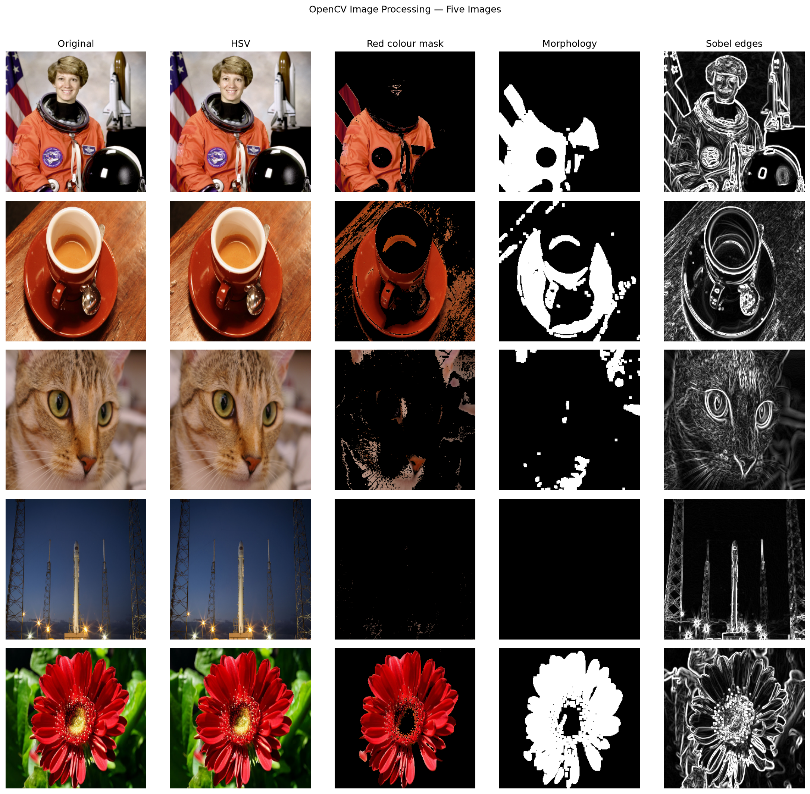
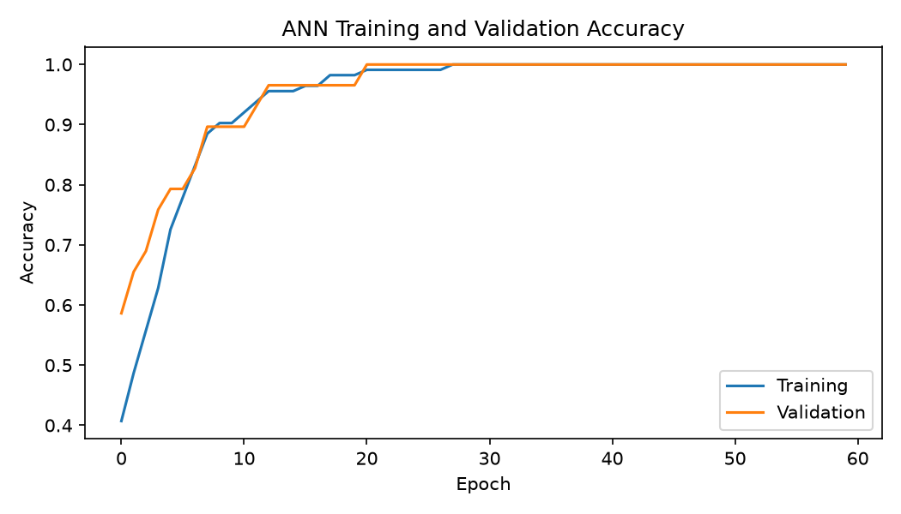
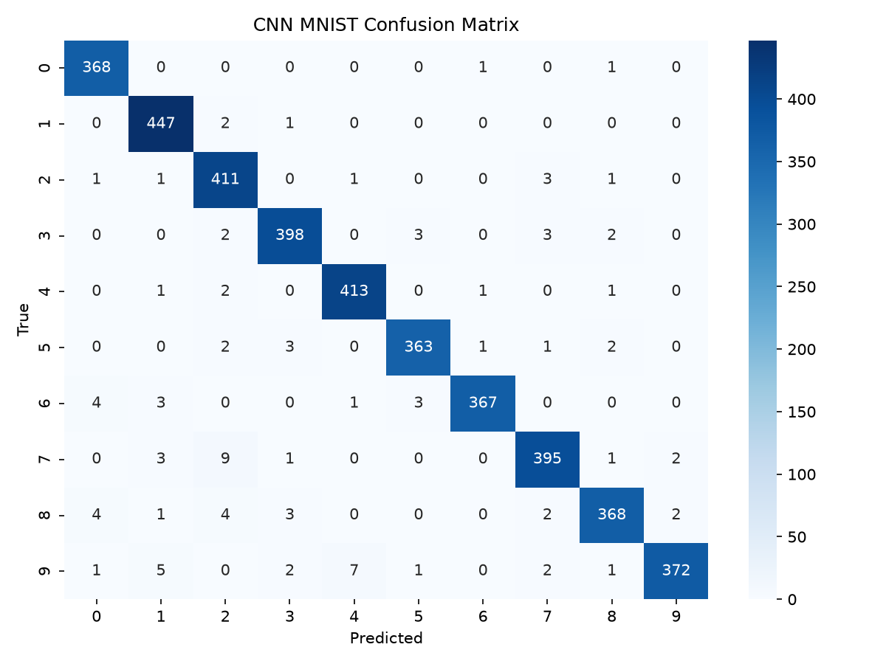
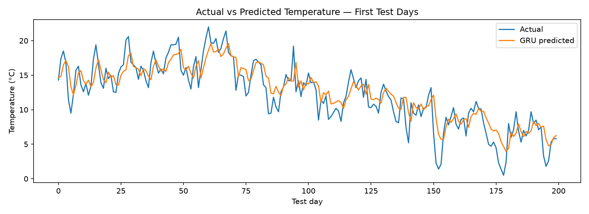
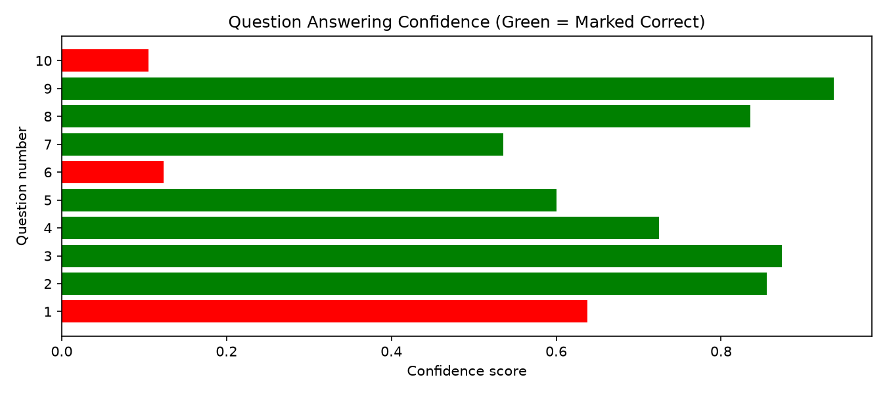

# 🧠 Deep Learning Practical Exam — Set C


> **Red & White Skill Education — Deep Learning Practical Exam**

A single-notebook practical covering five core tasks: ANN classification, OpenCV image processing, CNN digit recognition, GRU time-series forecasting, and pretrained Transformer inference.

## Objectives

- Build and evaluate an ANN for three-class Wine Recognition.
- Demonstrate colour conversion, colour masks, morphology, Sobel edges and Haar-cascade face detection.
- Compare a CNN with a dense ANN baseline on MNIST and inspect feature maps.
- Forecast Melbourne minimum temperatures with a GRU and compare with a naive baseline.
- Explore fill-mask, extractive question answering and text generation using pretrained Hugging Face pipelines.

## Dataset and model summary

| Step | Dataset / Input | Main result |
|---|---|---|
| ANN | scikit-learn Wine Recognition (178 samples, 13 features) | Test accuracy, classification report, confusion matrix |
| OpenCV | 4 `skimage` images + `data/images/RedFlower.jpg` | Processing grid and face detections |
| CNN | MNIST (20,000 train and 4,000 test subset) | CNN vs ANN accuracy and parameter counts |
| GRU | Daily Minimum Temperatures in Melbourne | RMSE/MAE compared with naive forecast |
| Transformers | 5 India-related paragraphs, 10 QA questions, 5 masked sentences, 3 generation prompts | Fill-mask, QA confidence and generated text |

## Key visualizations

The notebook saves these figures in `outputs/` when the relevant cells have run.

### 1. OpenCV image-processing grid



**Interpretation:** The grid compares each image's original view, HSV conversion, red mask, morphology-cleaned mask and Sobel edges.

### 2. ANN learning curves



**Interpretation:** Training and validation accuracy show whether the ANN is learning and whether its generalisation follows the training trend.

### 3. CNN confusion matrix



**Interpretation:** Diagonal cells are correct digit predictions; off-diagonal cells show which digits the CNN confuses.

### 4. GRU forecast



**Interpretation:** Actual and predicted temperatures show how closely the GRU follows the test series; compare the reported RMSE and MAE with the naive baseline.

### 5. Transformer QA confidence



**Interpretation:** Bars show answer confidence, coloured by the notebook's manual correctness check. Confidence alone does not guarantee correctness.

> Figures appear after running the notebook. Replace interpretations or summaries if your actual results reveal a more specific observation.

## Project structure

```text
DeepLearning_Practical_Exam_Set_C/
├── DeepLearning_Practical_Exam_SetC.ipynb
├── README.md
├── requirements.txt
├── summary_report.md
├── ann_wine_model.h5              # created by notebook
├── cnn_mnist_model.h5              # created by notebook
├── rnn_temperature_model.h5         # created by notebook
├── data/
│   └── images/
│       └── RedFlower.jpg
└── outputs/                         # generated plots and OpenCV images
```

## Setup and run

Python 3.11 is recommended for this environment.

```bash
# Activate the virtual environment on Windows CMD
.venv\Scripts\activate

# Install requirements
python -m pip install -r requirements.txt

# Launch Jupyter
python -m jupyter lab
```

Open `DeepLearning_Practical_Exam_SetC.ipynb`, select the project's `.venv` interpreter, and run all cells from top to bottom.

**Internet is required** for downloading the Melbourne CSV and the pretrained Hugging Face models. The MNIST dataset may also download on first use.

## Results

After running the notebook, the measured results are displayed in the final summary table and saved to `outputs/results_summary.csv`. Do not report target accuracies as actual results; use the numbers produced by your run.

## Demonstration video

**Video link:** Add your Google Drive (Anyone with the link can view) or unlisted YouTube URL here after recording.

## Author

**Paree Sojitra**  
GitHub: [PareeSojitra0803](https://github.com/PareeSojitra0803)
